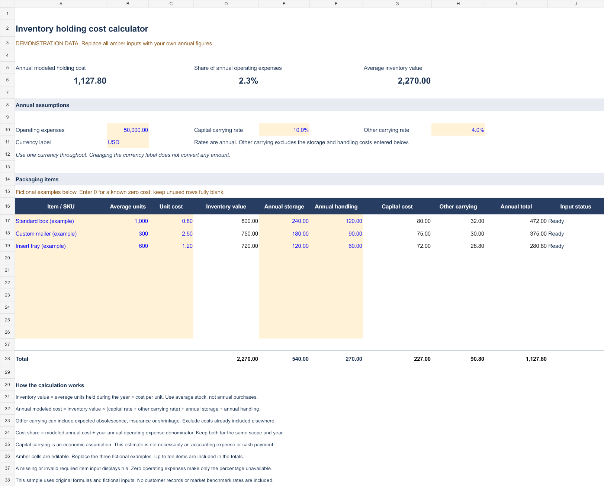

# Inventory holding cost calculator — editable Excel sample

An original, formula-based workbook for a small inventory cost calculation. The sample has ten item rows and three fictional packaging examples. No customer data or market benchmark rates are included.

[Download the Excel workbook](inventory-holding-cost-sample.xlsx) · [View the service and sample online](https://fencecalculatorpro.com/spreadsheet-tools)

## Use the sample

1. Download the `.xlsx` file and keep a backup.
2. Replace the amber input cells: annual operating expenses, currency label, annual capital and other carrying rates, item names, average units, unit costs, and annual storage/handling costs.
3. Review each row’s input status and the summary. Use one currency throughout; changing the label does not convert amounts. Leave unused rows completely blank and enter 0 for a known zero cost.

## Visible calculation rules

- Average inventory value = average units held × unit cost.
- Annual modeled holding cost = inventory value × (capital rate + other carrying rate) + annual storage + annual handling.
- Cost share = annual modeled holding cost ÷ annual operating expenses.

Use average stock rather than annual purchases. Keep costs within the same year and scope, and avoid including the same cost in both the carrying rate and the explicit storage/handling inputs. Capital carrying cost is a planning assumption; it may differ from an accounting expense or cash payment.

The fictional sample returns annual modeled cost **1,127.80**, average inventory value **2,270.00**, and cost share **2.2556%**. Invalid or missing required inputs display `n.a.`. Zero operating expenses make the percentage unavailable without removing valid cost totals.

## Need a calculation tailored to your business?

The [spreadsheet customization pilot](https://fencecalculatorpro.com/spreadsheet-tools#contact) starts at **US$49 once**: one workflow and currency, one input table up to 100 records, up to three agreed calculation relationships, one summary with usage notes, an editable `.xlsx` and one revision. Suitability, fixed scope, timing and payment method are confirmed before any order. An enquiry creates no order or payment obligation.

Start with column names and fictional rows; private customer records are not needed for an initial enquiry. Live feeds, macros, integrations and additional workflows are outside the base pilot. The free sample is available to use and adapt for your own business; customization is optional.

## Verification

Developed with AI assistance. Sample math, quantity edits, blank versus zero inputs, negative inputs, missing item names, the last reserved row, zero denominator behavior and XLSX re-import/recalculation were checked with Artifact Tool. Native Microsoft Excel was not used in these checks. There are no macros in the sample.
